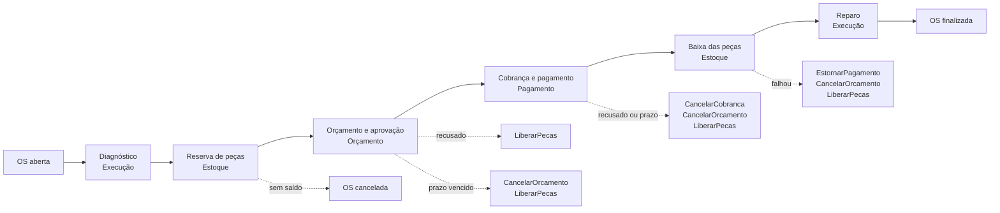

# oficina-mecanica-fiap

[](https://sonarcloud.io/summary/overall?id=phantosmia_oficina-mecanica-fiap) [](https://sonarcloud.io/component_measures?id=phantosmia_oficina-mecanica-fiap&metric=coverage)

MVP do back-end do Sistema Integrado de Atendimento e Execução de Serviços de uma oficina mecânica, desenvolvido em FastAPI com PostgreSQL, autenticação JWT, migrations Alembic, Docker, Kubernetes, Terraform AWS/EKS e pipeline GitHub Actions.

## Índice

- [Documentação complementar](#documentação-complementar)
- [Repositórios do projeto](#repositórios-do-projeto)
- [Visão geral](#visão-geral)
- [Saga Pattern: orquestração](#saga-pattern-orquestração)
- [Stack](#stack)
- [Como rodar rápido](#como-rodar-rápido)
- [Kubernetes e AWS](#kubernetes-e-aws)
- [Testes e qualidade](#testes-e-qualidade)
- [Observações](#observações)

## Documentação complementar

Os detalhes foram separados em artigos complementares para manter este README enxuto:

| Artigo | Conteúdo |
|---|---|
| [Arquitetura](docs/arquitetura.md) | Clean Architecture, estrutura de pastas, PostgreSQL, princípios aplicados e diagramas (ER, componentes C4, infraestrutura AWS, dependência entre repositórios, fluxo de deploy e sequência) |
| [Regras de negócio](docs/regras-negocio.md) | Fluxo da OS pelos microsserviços, status, cálculo do orçamento, reserva e baixa de estoque, compensações e prazos |
| [Execução local](docs/execucao-local.md) | Mise, Poetry, o sistema completo no Docker Compose e o passo a passo de uma OS atravessando os serviços |
| [Kubernetes e AWS](docs/kubernetes-aws.md) | Manifests, overlays, HPA, Terraform, EKS, ECR e Secrets Manager |
| [API e autenticação](docs/api.md) | JWT, endpoints públicos, endpoints administrativos e notas de uso |
| [Coleção Postman](postman/README.md) | Fluxo completo da OS pelos 6 serviços e as compensações, com ambientes `local` e `homologacao` |
| [Notificações por e-mail](docs/email.md) | SMTP, provedores compatíveis e configuração de envio |
| [Testes, carga e CI/CD](docs/testes-carga-ci.md) | Pytest, Testcontainers, BDD, Locust, HPA e GitHub Actions |
| [Segurança](docs/seguranca.md) | Bandit, pip-audit, Trivy e relatórios gerados |
| [Saga da ordem de serviço](docs/saga.md) | Fase 4: contratos entre os microsserviços (comandos, eventos, compensações, prazos e envelope das mensagens) |
| [RFCs](docs/rfcs/README.md) | Decisões técnicas relevantes: nuvem, banco, autenticação, API Gateway, monitoramento, decomposição em microsserviços, mensageria e separação de Orçamento e Pagamento |
| [ADRs](docs/adrs/README.md) | Decisões arquiteturais permanentes: padrão de comunicação, HPA, banco gerenciado, saga orquestrada e persistência poliglota |
| [Terraform AWS](infra/aws/README.md) | Stack AWS principal |
| [Terraform backend](infra/backend/README.md) | Backend remoto em S3 com lock em DynamoDB |

## Repositórios do projeto

O sistema é composto por 9 repositórios, cada um com CI/CD e regras de proteção próprias: 6 microsserviços ([RFC-0006](docs/rfcs/0006-decomposicao-em-microsservicos.md) e [RFC-0008](docs/rfcs/0008-separacao-orcamento-e-pagamento.md), contrato entre eles em [`docs/saga.md`](docs/saga.md)) e 3 repositórios de plataforma compartilhada por todos eles.

| Repositório | Papel | Tecnologia principal |
|---|---|---|
| [oficina-mecanica-fiap](https://github.com/phantosmia/oficina-mecanica-fiap) (este) | Microsserviço **OS Service**: clientes, veículos, ordens de serviço e orquestrador da saga | FastAPI + PostgreSQL |
| [oficina-mecanica-catalogo](https://github.com/phantosmia/oficina-mecanica-catalogo) | Microsserviço **Catálogo**: serviços e fichas de peças (consultado por REST síncrono, fora da saga) | FastAPI + DynamoDB |
| [oficina-mecanica-estoque](https://github.com/phantosmia/oficina-mecanica-estoque) | Microsserviço **Estoque**: saldo e reservas de peças (participante da saga) | FastAPI + PostgreSQL |
| [oficina-mecanica-orcamento](https://github.com/phantosmia/oficina-mecanica-orcamento) | Microsserviço **Orçamento**: geração do orçamento, envio para aprovação e aprovação/recusa (participante da saga) | FastAPI + DynamoDB |
| [oficina-mecanica-pagamento](https://github.com/phantosmia/oficina-mecanica-pagamento) | Microsserviço **Pagamento**: cobrança e estorno via Mercado Pago (participante da saga) | FastAPI + PostgreSQL |
| [oficina-mecanica-execucao](https://github.com/phantosmia/oficina-mecanica-execucao) | Microsserviço **Execução**: fila de execução, diagnóstico e reparo (participante da saga) | FastAPI + DynamoDB |
| [oficina-mecanica-lambda-auth](https://github.com/phantosmia/oficina-mecanica-lambda-auth) | Plataforma: autenticação via CPF e API Gateway | AWS Lambda + Terraform |
| [oficina-mecanica-infra-kubernetes](https://github.com/phantosmia/oficina-mecanica-infra-kubernetes) | Plataforma: VPC, cluster EKS, ECR e add-ons | Terraform |
| [oficina-mecanica-infra-banco-dados](https://github.com/phantosmia/oficina-mecanica-infra-banco-dados) | Plataforma: VPC de banco e RDS PostgreSQL | Terraform |

## Visão geral

Este repositório é o **OS Service**: o dono das ordens de serviço e o **orquestrador da saga** que coordena os outros cinco microsserviços ([ADR-0008](docs/adrs/0008-saga-orquestrada-no-os-service.md), contrato em [`docs/saga.md`](docs/saga.md)).

- abertura da OS com cliente, veículo e problema relatado; os serviços e peças vêm do diagnóstico do mecânico ([ADR-0010](docs/adrs/0010-diagnostico-define-o-orcamento.md))
- **saga orquestrada**: máquina de estados que envia comandos aos participantes (Estoque, Execução, Orçamento, Pagamento) por SQS e reage aos eventos deles, com **compensação** em ordem quando algo falha e **prazos** com reenvio
- avanço da saga, status da OS, histórico, comandos (outbox) e idempotência gravados **numa única transação**
- acompanhamento: listagem, detalhamento com itens e histórico de status, estado da saga, rastreio público pelo cliente (CPF/CNPJ ou JWT da Lambda de autenticação)
- CRUD de clientes e veículos; emissão do JWT de admin usado por todos os serviços
- testes: unitários da máquina de estados, integração com PostgreSQL (Testcontainers) e SQS/SNS (moto), e **BDD** do fluxo completo e das compensações ([docs/testes-carga-ci.md](docs/testes-carga-ci.md))
- `docker-compose.yml` com **os 6 microsserviços** rodando juntos, LocalStack e Mailpit
- migrations Alembic, Kubernetes (API, worker e relay), HPA, Locust, Terraform AWS/EKS e CI/CD
- logs estruturados em JSON, correlacionados por requisição (`X-Request-ID`) e por trace/span da APM (New Relic); `saga_id`/`order_id` propagados nas mensagens
- diagramas de arquitetura em [docs/arquitetura.md](docs/arquitetura.md) (da Fase 3; o diagrama da arquitetura de microsserviços está no checklist da Fase 4)

## Saga Pattern: orquestração

A abertura, o orçamento, a aprovação, o pagamento e a execução de uma OS passam por cinco serviços, cada um com seu próprio banco ([ADR-0009](docs/adrs/0009-persistencia-poliglota-por-servico.md)). Não existe uma transação que cubra todos eles. Até a Fase 3, aprovar o orçamento era um único `UPDATE` tudo ou nada no PostgreSQL; agora, se o pagamento falha depois que o Estoque já reservou as peças, alguém precisa desfazer a reserva. A saga faz isso: cada passo é uma transação local, e cada passo com efeito colateral tem uma **compensação** que o desfaz.

Escolhemos uma **saga orquestrada**, com o **orquestrador dentro deste serviço** (`app/saga/`) ([ADR-0008](docs/adrs/0008-saga-orquestrada-no-os-service.md)). O orquestrador manda comandos para a fila de cada participante (SQS) e reage aos eventos que eles publicam (SNS → fila `os-saga-eventos`) ([RFC-0007](docs/rfcs/0007-mensageria-sqs-sns.md)).



O fluxo completo, a tabela de compensações por ponto de falha e os prazos estão em [`docs/saga.md`](docs/saga.md).

### Por que orquestração, e não coreografia

- **O fluxo é longo e cada ponto de falha desfaz uma coisa diferente.** São seis etapas e nove pontos de falha, cada um com sua lista de compensações em ordem inversa (recusar o orçamento libera a reserva; perder o prazo do pagamento cancela a cobrança no Mercado Pago, depois o orçamento, depois a reserva). Na coreografia, cada serviço precisaria conhecer os eventos dos outros para decidir quando e o que compensar, e essa regra ficaria espalhada em cinco repositórios. Na orquestração, ela é uma máquina de estados pura, num arquivo só (`app/saga/domain/saga.py`), testada estado por estado.
- **Há esperas longas pelo cliente, com prazo.** A aprovação do orçamento e o pagamento dependem de uma pessoa. Alguém precisa saber que a OS 42 está esperando o pagamento desde ontem e agir quando o prazo vence. Na orquestração, esse alguém é o orquestrador, que guarda o prazo de cada saga e tem uma verificação periódica. Na coreografia, não haveria um dono natural para esse relógio.
- **O estado de cada OS fica num lugar só.** `GET /service-orders/{id}/saga` mostra a etapa atual, o comando em espera, as tentativas, o prazo e as compensações pendentes. Na coreografia, responder "em que passo está a OS e o que falta desfazer?" exigiria juntar o estado de vários serviços.
- **Os participantes ficam simples.** Cada um recebe um comando, executa e publica o resultado, sem saber em que fluxo está. Isso também os mantém reaproveitáveis: o Estoque reserva peças para quem pedir.

### Por que o orquestrador fica no OS Service

O OS Service é o dono da ordem de serviço, e a saga existe para fazer a OS andar. Com o orquestrador aqui, **avançar a saga, mudar o status da OS, gravar o histórico e enfileirar o próximo comando acontecem numa única transação local** (outbox). Num serviço separado, o estado da saga e o status da OS ficariam em bancos diferentes e precisariam de mais uma troca de mensagens, com prazo e reenvio, só para continuarem sincronizados. É também o desenho de referência do padrão (*Microservices Patterns*, Chris Richardson): a saga fica no serviço que é dono do agregado. O módulo `app/saga/` não importa os outros contextos do serviço, então pode ser extraído para um serviço próprio se um dia fizer sentido.

### Como o rollback fica seguro

- **Outbox transacional nos 6 serviços**: o comando ou evento é gravado na mesma transação do efeito colateral, e um relay o publica depois. Uma queda entre as duas coisas não perde nem duplica mensagem de forma inconsistente.
- **Idempotência por `message_id`**: o orquestrador e os 4 participantes registram as mensagens que já processaram, na mesma transação do efeito. A entrega "pelo menos uma vez" do SQS pode repetir uma mensagem sem efeito duplicado.
- **Compensações idempotentes e sempre confirmadas**: elas respondem com confirmação mesmo quando não havia nada a desfazer. O orquestrador as reenvia até receber a confirmação e só marca a OS como cancelada quando todas chegaram. Uma compensação que esgota as tentativas fica parada e visível para intervenção (`POST /service-orders/{id}/saga/retry`), nunca é abandonada.
- **Prazos com reenvio**: participante que não responde recebe o comando de novo (até 3 vezes) antes de a saga compensar.
- **Ponto sem volta explícito**: depois que o reparo entra na fila, as peças começam a ser usadas no carro e a saga não compensa mais. Problemas a partir dali são tratados pela oficina.

### O que se aceitou em troca

O OS Service concentra a coordenação e é o serviço mais crítico do sistema. Se ele cair, nenhuma saga avança, mas nenhuma se perde: as mensagens esperam nas filas e o estado está no banco. A troca valeu pela legibilidade do fluxo e por ter um único lugar para testar e acompanhar cada OS.

### Onde ver funcionando

- **Testes**: a máquina de estados tem testes unitários de cada transição e compensação (`tests/test_saga_state_machine.py`), e o fluxo completo e três compensações (recusa do orçamento, pagamento não concluído e falha depois do pagamento) estão em BDD (`tests/features/fluxo_ordem_de_servico.feature`).
- **Na prática**: a [coleção Postman](postman/README.md) roda o fluxo completo e as compensações contra o Compose ou a AWS.
- **No New Relic**: um trace distribuído acompanha a OS de serviço em serviço, e `saga_id`/`order_id` aparecem em todos os logs (ver [`docs/saga.md`](docs/saga.md#envelope-das-mensagens)).

## Stack

- FastAPI
- PostgreSQL 16
- SQLAlchemy 2 + psycopg 3
- Alembic
- Poetry
- Pytest + Testcontainers
- Docker e Docker Compose
- Kubernetes + Kustomize + HPA
- Locust
- Terraform
- AWS EKS, ECR, RDS, Secrets Manager e S3 backend (EKS/ECR provisionados pelo repositório `oficina-mecanica-infra-kubernetes`; RDS pelo repositório `oficina-mecanica-infra-banco-dados`)
- GitHub Actions

## Como rodar rápido

O `docker-compose.yml` sobe **o sistema inteiro da Fase 4**: os 6 microsserviços (cada um com API, worker e relay), LocalStack (SQS, SNS e DynamoDB) e Mailpit (caixa de e-mail de teste). Os repositórios dos outros serviços precisam estar clonados ao lado deste (`../oficina-mecanica-catalogo`, `../oficina-mecanica-estoque`, ...).

```bash
docker compose up --build
```

| Serviço | Swagger |
|---|---|
| OS Service (este) | `http://localhost:8000/docs` |
| Catálogo | `http://localhost:8001/docs` |
| Estoque | `http://localhost:8002/docs` |
| Execução | `http://localhost:8003/docs` |
| Orçamento | `http://localhost:8004/docs` |
| Pagamento | `http://localhost:8005/docs` |
| Mailpit (e-mails enviados) | `http://localhost:8025` |

O Pagamento fala com o sandbox do Mercado Pago se existir `../oficina-mecanica-pagamento/.env` com as credenciais de teste (ver o README de lá). O passo a passo de uma OS atravessando os serviços está em [docs/execucao-local.md](docs/execucao-local.md). A [coleção Postman](postman/README.md) faz o mesmo fluxo, incluindo as compensações, com ambientes para o Compose e para a AWS.

Para parar:

```bash
docker compose down
```

Para rodar localmente com Poetry:

```bash
docker compose up -d os-db
poetry install
poetry run alembic upgrade head
poetry run uvicorn app.main:app --reload
```

Credenciais administrativas padrão para ambiente local:

| Campo | Valor |
|---|---|
| Usuário | `admin` |
| Senha | `Admin@123` |

O projeto também possui tasks no [.mise.toml](.mise.toml):

```bash
mise install
mise run db-up
mise run migrate
mise run dev
mise run test
```

Mais detalhes ficam em [docs/execucao-local.md](docs/execucao-local.md).

## Kubernetes e AWS

Aplicar Kubernetes local:

```bash
kubectl apply -k k8s/overlays/local
```

Aplicar no AWS Academy Lab:

```bash
kubectl apply -k k8s/overlays/aws-academy
```

Aplicar no AWS/EKS completo:

```bash
kubectl apply -k k8s/overlays/aws
```

O HPA escala a API entre 2 e 5 pods por CPU/memória. Para demonstrações, o scale-up foi configurado sem janela artificial de 1 minuto.

Para simular carga com Locust dentro do cluster:

```bash
mise run k8s-load-run
mise run k8s-hpa-watch
mise run k8s-load-logs
```

Detalhes operacionais:

- Kubernetes e AWS: [docs/kubernetes-aws.md](docs/kubernetes-aws.md)
- Terraform AWS (secret + IRSA da API): [infra/aws/README.md](infra/aws/README.md)
- Terraform backend S3/DynamoDB: [infra/backend/README.md](infra/backend/README.md)
- Terraform do cluster EKS/VPC/ECR: [oficina-mecanica-infra-kubernetes](https://github.com/phantosmia/oficina-mecanica-infra-kubernetes)
- Terraform do RDS: [oficina-mecanica-infra-banco-dados](https://github.com/phantosmia/oficina-mecanica-infra-banco-dados)
- Teste de carga e HPA: [docs/testes-carga-ci.md](docs/testes-carga-ci.md)

## Testes e qualidade

Rodar testes:

```bash
poetry run pytest
```

Gerar relatório de segurança:

```bash
bash scripts/security_scan.sh
```

O pipeline de CI executa testes com PostgreSQL efêmero via Testcontainers, envia o código e a cobertura para análise no [SonarCloud](https://sonarcloud.io/organizations/phantosmia/projects) (o CI falha se o Quality Gate falhar; os 6 microsserviços seguem o mesmo padrão), valida build Docker e valida Terraform/Kustomize.

Mais detalhes:

- Testes, Locust e CI/CD: [docs/testes-carga-ci.md](docs/testes-carga-ci.md)
- Segurança e relatórios: [docs/seguranca.md](docs/seguranca.md)

## Observações

- O histórico de clientes, veículos, peças e ordens fica persistido no PostgreSQL.
- A conexão com o banco é configurada por `DATABASE_URL` ou pelas variáveis `POSTGRES_*`.
- Segredos reais devem ficar fora do Git, em `.env`, `.aws_credentials`, `terraform.tfvars`, `backend.hcl`, GitHub Secrets ou AWS Secrets Manager.
- A documentação OpenAPI é gerada automaticamente pelo FastAPI em `/docs` e `/redoc`.
